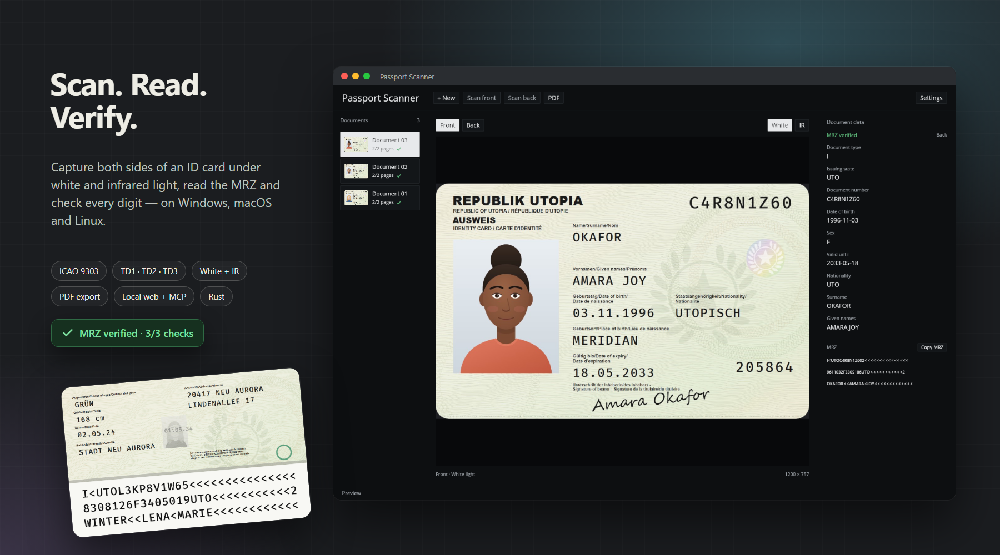
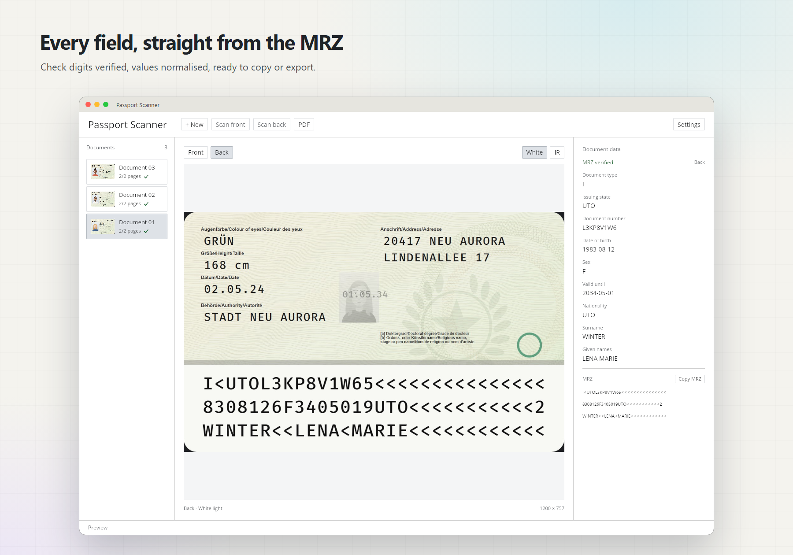
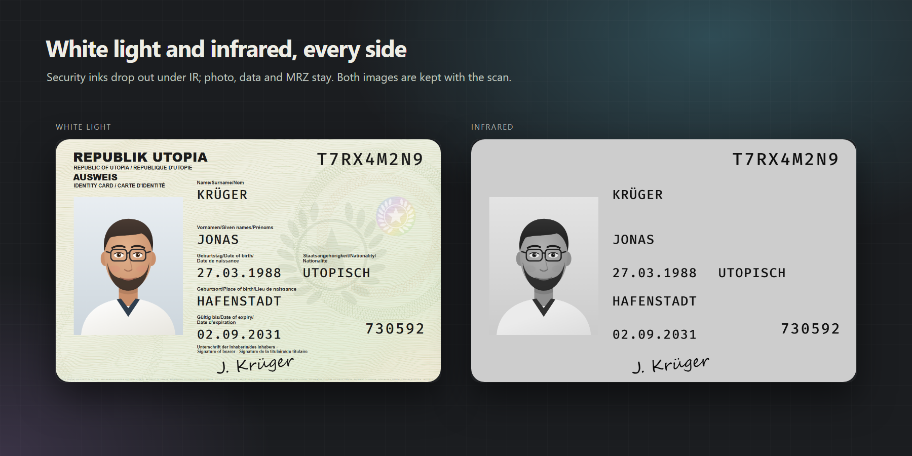

# Passport-Scanner-Rust


An independent, cross-platform reimplementation of the user-mode stack for 
Plustek SecureScan ID document scanners, in Rust. It is not derived from, 
and shares no code with, the manufacturer's software. It was written to 
make these scanners usable from Rust, from other languages and from Linux. 



## Compatibility

This software works with Plustek SecureScan series scanners. It is developed and tested against the X-Mini 200. The model table covers all eleven product ids the family is known to use, but only the X-Mini 2000 has been verified against hardware.

> **Not a Plustek product.** This project is not made, supplied, endorsed,
> sponsored or supported by Plustek. Do not contact Plustek about it. See
> [Names and trade marks](#names-and-trade-marks).

## Features





- **Capture:** white and infrared light, 2592×1944, both sides of a document
- **Device control:** lamps, buzzer, presence sensors, registers, EEPROM
- **Calibration:** uses the factory calibration or measures its own
- **Imaging:** crop, illumination flattening, tone and colour correction, sharpening
- **Recognition:** MRZ (ICAO 9303 TD1/TD2/TD3) with check digits, OCR in any orientation
- **Output:** JPEG per capture, multi-page PDF, structured scan records

## Layout

```
crates/
  passport-scanner-core       traits and domain types (no I/O, no platform code)
  passport-scanner-device     scanner protocol: commands, EEPROM, registers
  passport-scanner-imaging    image pipeline
  passport-scanner-mrz        MRZ parser
  passport-scanner-recognize  OCR and MRZ validation
  passport-scanner-app        scanner session, PDF, local web and MCP services
  passport-scanner-desktop    Iced desktop app
```

## Extending

Each extension point is a trait in `passport-scanner-core`. New implementations go
in their own crate; nothing else changes.

| To add | Implement |
|--------|-----------|
| an OS backend | `VendorTransport` |
| a capture backend | `FrameSource` |
| a scanner model | `ScannerDevice` + a `Model` entry |
| an image correction | `ImageProcessor` |
| a data extractor | `DocumentRecognizer` |

## Building

Needs a Rust toolchain. On Windows the MSVC linker is required, so install the Visual Studio Build Tools with the C++ workload. On Windows, build from PowerShell rather than Git Bash: the GNU `link` in the Git Bash path shadows the MSVC linker of the same name.

```sh
cargo test
cargo clippy --all-targets
```

## Releases

Publishing a GitHub release with a version tag such as `v0.2.0` starts
`.github/workflows/release.yml`. It builds Windows (x64), macOS (Apple silicon)
and Linux (x64), stamps the tag into the programs as their version, and attaches
to the release:

- `passport-scanner-windows-x64.zip`, `passport-scanner-macos-arm64.zip`,
  `passport-scanner-linux-x64.zip` - the program folder, user guide included
- `Passport-Scanner-User-Guide.pdf` and `LICENSE`

The desktop program asks GitHub for the latest release when it starts and
offers to install it when it is newer. It downloads its platform's archive,
checks it against the SHA-256 digest GitHub reports, replaces the program files
and restarts on request. The archive names above are what it looks for; change
them in `build.yml` and `crates/passport-scanner-desktop/src/update.rs`
together. Development builds never update themselves.

Inside each archive the desktop program is `Passport Scanner`; the other
programs sit in `tools/` (web, MCP, command-line scanning) and `debug-tools/`
(hardware and imaging diagnostics), as `scripts/release-layout.txt` places
them. `package.ps1` builds `dist\` in the same layout.

### Boundaries kept, deliberately

- Decompilation was used only where observation could not answer the question,
  and only on the parts that had to be understood to talk to the device.
- Nothing learned was passed to anyone for any purpose other than this
  interoperable implementation.
- No manufacturer code, resource, model file, profile or data file is copied
  into or redistributed with this project. The third-party recognition engines
  the manufacturer's software bundles are not used, not reimplemented and not
  shipped; recognition here is Tesseract and this project's own code.
- Nothing bypasses a technical protection measure, a licence check or an
  activation. The manufacturer's licensing component is not touched.

This is a reimplementation for interoperability, not a substitute product built
out of someone else's work, and it is not represented as the manufacturer's.

## Names and trade marks

*Plustek*, *SecureScan* and the scanner model names are used here for one
purpose: to identify the hardware this software works with, and the
manufacturer's software whose behaviour it had to match. So, explicitly:

- All trade marks are the property of their respective owners. *Plustek* is a
  mark of the Plustek group; no claim to it is made here.
- This project is **not affiliated with, authorised by, endorsed by or connected
  to Plustek** in any way.
- No manufacturer logo, icon, typeface or other branding is used or
  redistributed.
- The names appear in statements of compatibility and in technical
  documentation. They are not a claim that this software comes from the
  manufacturer or has their approval.

## Documentation

- [docs/user/](docs/user/) - user guide; each release attaches it as one PDF
  and puts it in every program archive (`scripts/build-user-guide.sh`)
- [docs/implementation/](docs/implementation/) - protocol, calibration and
  recognition internals